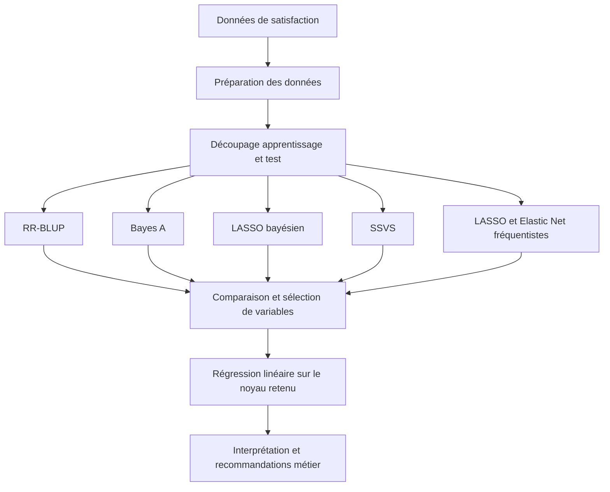

# Bayesian Regression & Variable Selection — TV Customer Satisfaction

  

> Prédiction de la satisfaction des abonnés d'une chaîne câblée et identification des programmes associés à cette satisfaction dans un contexte de grande dimension (p > n).

**Projet académique — ENSAI | Mastère Spécialisé Science des données pour la Connaissance Client | 2025–2026**

## 1. Contexte et objectifs

Un opérateur de télévision souhaite comprendre comment les habitudes de visionnage de ses abonnés sont associées à leur satisfaction, afin d'orienter ses décisions en matière de programmation et d'investissement.

L'étude poursuit deux objectifs complémentaires :

- Prédire le score de satisfaction à partir des comportements de consommation.
- Identifier les chaînes les plus pertinentes pour expliquer ce score, en comparant plusieurs mécanismes de régularisation et de sélection de variables.

La difficulté statistique réside dans le nombre de prédicteurs, supérieur au nombre d'observations disponibles pour l'apprentissage. Les approches pénalisées et bayésiennes permettent de stabiliser l'estimation dans ce contexte.

## 2. Données et protocole expérimental

| Élément | Description |
|---|---|
| Source | `telecat.csv` — enquête de satisfaction |
| Population | 150 abonnés |
| Cible | `Y`, score continu de satisfaction |
| Prédicteurs principaux | 160 scores normalisés de consommation des chaînes (temps passé et nombre de visites) |
| Variable complémentaire | Sexe, étudié dans une extension avec BLR |
| Apprentissage | 100 observations |
| Test | 50 observations |
| Graine aléatoire | `set.seed(1234)` |

Les chaînes couvrent neuf familles : films, séries, sport, sciences, actualité, musique, jeux, histoire/documentaires et programmes divers. La colonne d'index et la variable sexe sont exclues de l'analyse principale.

## 3. Pipeline méthodologique



## 4. Approches statistiques

| Méthode | Principe |
|---|---|
| RR-BLUP | Régression à effets aléatoires avec variance commune et shrinkage de type Ridge |
| Bayes A | Modèle hiérarchique avec variances spécifiques aux coefficients ; shrinkage adaptatif |
| LASSO bayésien | Prior de Laplace et régularisation contrôlée par lambda (1 et 2 étudiés) |
| SSVS | Recherche stochastique de sous-ensembles et probabilités d'inclusion a posteriori |
| LASSO fréquentiste | Pénalisation L1 avec choix du paramètre par validation croisée |
| Elastic Net fréquentiste | Combinaison des pénalités L1 et L2 |
| OLS | Régression linéaire sur dix variables issues de la sélection |

Le rapport comprend l'implémentation de fonctions de simulation MCMC, l'étude du burn-in, l'examen visuel des trajectoires, la comparaison des distributions a priori et a posteriori et la construction d'intervalles crédibles à 95 %. Pour Bayes A, une configuration étudiée utilise 6 000 itérations dont 1 000 de burn-in et des hyperparamètres inverse-gamma de 0,001.

## 5. Résultats prédictifs

La métrique principale est la corrélation entre les scores observés et prédits sur les 50 observations de test.

| Modèle | Corrélation test | Variables retenues |
|---|---:|---:|
| **LASSO fréquentiste** | **0,8988** | 62 |
| Elastic Net fréquentiste | 0,8941 | — |
| **Bayes A** | **0,8737** | **10** |
| LASSO bayésien (lambda = 2) | 0,8559 | 12 |
| LASSO bayésien (lambda = 1) | 0,8442 | — |
| OLS | 0,8175 | 10 |
| RR-BLUP | 0,8096 | 40 |
| SSVS | — | 38 |

Les valeurs sont reprises des sorties numériques du rapport HTML et arrondies à quatre décimales. Pour Elastic Net, la sortie numérique (0,8940869) diffère du tableau récapitulatif du rapport (0,8915) ; la sortie numérique est retenue ici. Un tiret signifie que l'indicateur n'est pas présenté dans ce tableau, et non qu'il vaut zéro.

**Enseignement principal :** le LASSO fréquentiste obtient la meilleure corrélation observée, tandis que Bayes A offre un compromis intéressant entre performance et parcimonie, avec dix variables retenues selon le critère d'intervalle crédible. Les nombres de variables ne sont pas directement comparables sans tenir compte des critères de sélection propres à chaque méthode.

## 6. Sélection et interprétation

Les dix chaînes retenues par Bayes A et également identifiées par RR-BLUP et le LASSO bayésien (lambda = 2) sont :

- Films : `Film.1`, `Film.8`, `Film.10`
- Séries : `Serie.8`, `Serie.9`
- Sport : `Sport.10`, `Sport.11`, `Sport.12`, `Sport.15`
- Musique : `Music.13`

Le modèle OLS construit sur ce noyau atteint un R² d'apprentissage de 0,8796 (R² ajusté : 0,866), pour une corrélation test de 0,8175. Cette distinction entre ajustement et généralisation est essentielle pour comparer les modèles.

## 7. Applications métier

Les résultats suggèrent des pistes d'investigation pour l'opérateur :

- Renforcer l'attractivité des contenus sportifs identifiés.
- Étudier les possibilités de développement des films, séries et contenus musicaux associés à une satisfaction plus élevée.
- Utiliser la prédiction comme outil d'aide à la décision, en complément d'indicateurs d'audience, de coûts et de rentabilité.
- Tester les actions envisagées avant d'allouer les budgets de programmation.

Ces associations statistiques ne démontrent pas un effet causal des programmes sur la satisfaction.

## 8. Extensions et approfondissements

Le rapport aborde également :

- L'intégration de la variable sexe dans un modèle avec le package `BLR`.
- La sensibilité de SSVS aux hyperparamètres et la régularisation des matrices pour éviter les problèmes d'inversion.
- Un schéma hiérarchique de régression de Poisson et l'introduction d'indicateurs de sélection.
- Le cadre théorique de l'Elastic Net bayésien et une comparaison empirique avec Elastic Net fréquentiste.
- La dérivation des lois conditionnelles complètes de Bayes A.
- Une variante accélérée de SSVS : 18 variables retenues avec un seuil d'inclusion de 0,3 dans la configuration présentée.

## 9. Technologies

- **R** — programmation statistique et modélisation.
- **rrBLUP** — estimation RR-BLUP.
- **mvtnorm**, **statmod**, **monomvn** — environnement de simulation et calcul statistique.
- **glmnet** — régressions pénalisées et validation croisée.
- **BLR** — régression bayésienne.
- **knitr / Pandoc** — rapport HTML intégrant code, sorties et graphiques.

## 10. Consulter et reproduire l'étude

Le dépôt peut être organisé comme suit (en conservant les noms de fichiers d'origine) :

```text
.
├── README.md
├── Sujet_TP_regression_bayesienne(1).pdf
└── TP_Allakonon_deogratias_2025_2026(1).html
```

- [Rapport d'analyse HTML](TP_Allakonon_deogratias_2025_2026%281%29.html) : à télécharger puis ouvrir dans un navigateur si GitHub affiche le code source.
- [Sujet du TP](Sujet_TP_regression_bayesienne%281%29.pdf) : contexte et consignes pédagogiques.

Pour réexécuter les traitements, disposer de R, de `telecat.csv` et récupérer les blocs R du rapport (ou le fichier R Markdown original, s'il est disponible). Les principaux packages peuvent être installés, sous réserve de compatibilité avec la version de R, avec :

```r
install.packages(c("rrBLUP", "mvtnorm", "monomvn", "glmnet", "BLR", "statmod"))
```

Le jeu de données et le fichier source R Markdown ne sont pas fournis avec les documents disponibles ; une reproduction intégrale n'a donc pas été vérifiée. Le rapport HTML n'est pas lui-même un script exécutable.

## 11. Limites et perspectives

- Taille d'échantillon limitée et évaluation sur un seul découpage apprentissage/test.
- Comparaison à compléter par RMSE, MAE, validation croisée répétée et diagnostics MCMC quantitatifs.
- Sensibilité des sélections aux priors, aux hyperparamètres et aux seuils utilisés.
- Absence de démonstration causale ou de validation de l'impact commercial des recommandations.

## Auteur

**Deogratias ALLAKONON** — ENSAI, année académique 2025–2026.

Rapport daté du 22 février 2026.

Avant publication publique, vérifier les droits de diffusion du sujet pédagogique, des données et des résultats. Aucune licence de redistribution n'est présumée.
